<picture data-importer="pacman">
  <source media="(prefers-color-scheme: dark)" srcset="https://raw.githubusercontent.com/enzolealcav/enzolealcav/pacman-output/pacman-contribution-graph-dark.svg?game=pacman">
  <source media="(prefers-color-scheme: light)" srcset="https://raw.githubusercontent.com/enzolealcav/enzolealcav/pacman-output/pacman-contribution-graph.svg?game=pacman">
  
</picture>

# 👾 About me:
🎓 Student of **Computer Science at CESAR School** | Recife, Brazil.

💻 Interested in software development, technology, hardware, and cybersecurity.

🚀 Currently developing academic and personal projects, exploring technologies, and improving my programming skills, especially in Python, C++, and web development.

🛠️ Always looking to learn, build solutions, and turn ideas into real-world projects.  🌎 English: C1 Advanced Certified — NCG Liverpool, UK.

## 🌐 **Social Media**:
 

# 💻 Tech Stack:
       
# 📊 GitHub Stats:
 
 

---

<!-- Proudly created with GPRM ( https://gprm.itsvg.in ) -->
